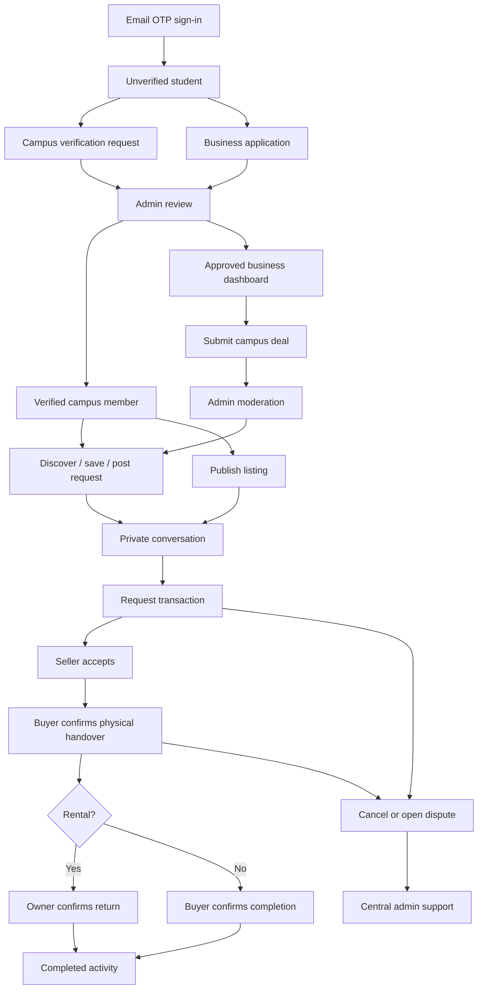

# UniCirq V1 implementation plan

UniCirq — Your Campus, Connected.

## Product decisions recovered from Student Marketplace Features
Student-first, campus-scoped, asset-light marketplace. Zero P2P commission for the pilot. Seed supply from students, clubs and graduating batches. Requests capture unmet demand. Keep conversations and activity records in UniCirq. Trust reflects verification and recorded activity, never an invented credit score. Payments, protection fees, deposits, QR handover, storage and merchandise require later integrations and are not represented as live financial services.

The selected direction uses navy sidebars, cobalt accents, compact top navigation, campus banners and responsive white cards across Student, Business and Admin. Mobile layouts use a navigation drawer. See MEMBER-DESIGN.md and ADMIN-DESIGN.md.

## Build sequence
1. Typed domain, validation, authorization rules and seeded local demo.
2. Better Auth email OTP authentication, server session verification and protected role layouts.
3. Student discovery, marketplace, rentals, hardware, services, requests, saved items.
4. Listing details/creation, conversations, transaction requests and state transitions.
5. Profile and verification, notifications, support and managed-sale intake.
6. Business directory/deals and admin moderation/verification foundations.
7. PostgreSQL schema, RLS, transactional command RPC and production setup.
8. Type/build checks, authorization and database integration tests, responsive browser review.

## Project structure
```
src/app/                 Next.js routes; student, business and admin layouts
src/app/api/             OTP, demo session, authenticated snapshots and commands
src/components/          Shared shell, forms, listing cards and module screens
src/lib/domain.ts        Entities and command validation
src/lib/policy.ts        Role, campus, ownership and transaction rules
src/lib/demo.ts          Local-only seeded repository
src/lib/server/          Verified sessions and production PostgreSQL adapter
database/migrations/     Normalized schema, RLS, RPC, rate limits and audit log
database/seed.example.sql        Public campus catalog (no fabricated production accounts)
tests/                  Policy, validation and PostgreSQL/RLS integration checks
```

## Roles and identity
Production uses Better Auth email OTP, PostgreSQL and Resend. Email verification and campus verification are separate. New accounts receive an unverified Student profile from a database trigger; metadata cannot assign roles. Administrators approve campus and business applications. A trusted operator bootstraps the first Admin. Better Auth validates database sessions on the server; PostgreSQL profiles determine role, campus and suspension status. Layouts and API commands independently enforce authorization. The restricted runtime login can manage auth tables and assume unicirq_app. Every application transaction uses SET LOCAL ROLE and a transaction-local user ID taken from the verified session. Row-level policies constrain reads; direct application-table writes are denied. A transactional security-definer command function rechecks roles, ownership, campus and state transitions. Never deploy with the migration-owner login.

The local demo is explicitly enabled, disabled on Vercel and in production, and uses signed HTTP-only sessions for fixed seeded identities. Its state lives in the development server process and resets on restart. Demo identity switching never exists in production.

## Data model
Colleges have profiles, listings, requests and deals. Profiles own listings/requests/saves, participate in conversations/orders, and receive notifications. Listings unify sale, rental, hardware and service inventory. Conversations have exactly two participants and immutable listing/request context. Orders reference listing, buyer and seller and retain the original title, price, unit, condition, description and meeting place. Immutable order events record the actor, status and time; state changes require the correct participant. Support tickets optionally reference a participant's order or a visible listing. Verification requests and business profiles are private/admin scoped. Audit logs preserve moderation actor and reason. All money is integer INR paise.

## Workflow


There is no Paid state in this release: no payment provider is connected, and activity records never claim escrow, insurance, payment confirmation or deposit protection. QR/OTP handover evidence and provider-confirmed payments are future adapters. In-person inspection and participant confirmation are available now.
